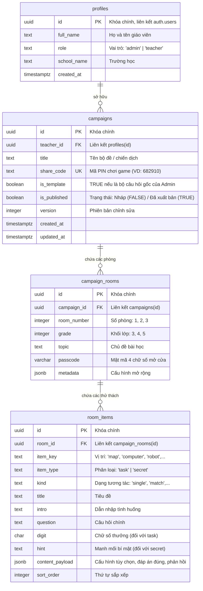

# BÁO CÁO PHÂN TÍCH KIẾN TRÚC VÀ THIẾT KẾ HỆ THỐNG SUPABASE
# DỰ ÁN AI ESCAPE LAB (DÀNH CHO KHỐI 3, 4, 5)

---

## 1. CẤU TRÚC MÃ NGUỒN HIỆN TẠI

### 1.1. Tổng quan kiến trúc
- **Kiểu ứng dụng**: Ứng dụng web một trang (Single Page Application - SPA) chạy hoàn toàn trên trình duyệt bằng HTML5, CSS3 và Vanilla JavaScript thuần (ES6+), không phụ thuộc vào framework (React, Vue) hay công cụ đóng gói (Vite, Webpack).
- **Cơ chế chuyển cảnh**: Dùng class CSS `.hidden` để ẩn/hiện các `<section>` màn hình chính trong `index.html`.
- **Cơ chế lưu trạng thái**: Hoàn toàn cục bộ phía client bằng `localStorage` theo từng khối lớp:
  - `ai-escape-lab-avatar`: Lưu tùy chọn nhân vật học sinh (`boy` / `girl`).
  - `ai-escape-lab-access-grade-{g}`: Lưu quyền mở khóa phòng chơi cao nhất đã đạt được (từ 1 đến 16).
  - `ai-escape-lab-v23-grade-{g}`: Tiến độ Room 01 (chữ số đã tìm, nhiệm vụ đã xong, manh mối đã mở, số lần sai, trợ giúp).
  - `ai-escape-lab-room2-grade-{g}`: Tiến độ Room 02 (các trạm kiến thức đã xem, chặng khôi phục, số lần sai).
  - `ai-escape-lab-room3-grade-3`: Tiến độ Room 03 (chặng chơi, vật phẩm thu thập, tình trạng lắp ráp, trạm mở, phân loại băng chuyền, vị trí an toàn).

### 1.2. Danh mục tệp tin và vai trò
| Tên tệp | Vai trò và phạm vi hoạt động |
| :--- | :--- |
| `index.html` | Cấu trúc khung giao diện: Welcome screen, Grade selection, Map 16 phòng, Canvas Room 01, DOM layout Room 02 & Room 03, Modal giải đố và Avatar picker. |
| `style.css` | Toàn bộ định dạng giao diện, hiệu ứng responsive, bố cục CSS Grid/Flexbox, kiểu dáng nút bấm và theme màu sắc riêng cho từng khối lớp. |
| `game.js` | **Lõi điều khiển chính & Room 01**: Game loop Canvas (1536×1024), di chuyển nhân vật, va chạm vật lý, hệ thống 4 nhiệm vụ chính + 4 manh mối bí mật, cơ chế mở khóa mật mã cửa 4 chữ số, quản lý bản đồ 16 phòng và chuyển cảnh. |
| `room2.js` | **Phòng 02 - Trung tâm phục hồi**: Quản lý 4 trạm kiến thức lý thuyết và 4 thử thách phục hồi hệ thống tại trạm trung tâm theo từng khối lớp 3, 4, 5. |
| `room3.js` | **Phòng 03 - Mê cung máy tính**: Thế giới mini-game của khối 3 gồm 4 chặng: Tìm linh kiện & lắp ráp máy tính $\rightarrow$ Khôi phục 3 trạm an ninh điều khiển $\rightarrow$ Vận hành băng chuyền phân loại $\rightarrow$ Kiểm tra an toàn điện. |
| `avatar-settings.js` | Modal chọn và chuyển đổi nhân vật đồng hành (Học sinh nam / Học sinh nữ), phát sự kiện `ai-avatar-change`. |
| `touch-controls.js` | Bàn phím điều hướng ảo (D-pad) và nút tương tác cảm ứng dành cho thiết bị di động / máy tính bảng. |
| `room-completion.js` | Module sinh thông báo và giao diện chúc mừng khi hoàn thành phòng chơi. |
| `assets/` | Ảnh nền màn hình, bản đồ, phòng chơi, sprite nhân vật theo 4 hướng (`up`, `down`, `left`, `right`) và ảnh các thiết bị máy tính. |

---

## 2. CÁC DẠNG NHIỆM VỤ CỦA ROOM 01, 02, 03 THEO TỪNG KHỐI LỚP

### 2.1. Room 01 – Trung tâm điều khiển (Canvas 2D)
Mỗi lớp có **4 nhiệm vụ chính** (thu thập 4 chữ số) và **4 nhiệm vụ phụ/bí mật** (thu thập manh mối suy luận thứ tự mật mã):

#### Khối 3 (Chủ đề: *Thông tin và quyết định* – Mật mã cửa: `4279`)
- **Nhiệm vụ chính (`tasks`)**:
  - `map` (Nhận số `4`): Dạng **`match`** – Ghép nối 2 cột (3 cặp) giữa Thông tin nhận được và Quyết định phù hợp.
  - `computer` (Nhận số `2`): Dạng **`sequence`** – Chuỗi 3 câu hỏi trắc nghiệm liên tiếp xác định giác quan tiếp nhận thông tin (Mắt hay Tai).
  - `library` (Nhận số `7`): Dạng **`sequence`** – Đọc thông báo chuyến đi dã ngoại và trả lời chuỗi 2 câu hỏi liên tiếp.
  - `station` (Nhận số `9`): Dạng **`multi`** – Chọn nhiều đáp án đúng (tình huống một thông tin mưa to dẫn đến nhiều quyết định).
- **Manh mối bí mật (`secrets`)**:
  - `robot`: Dạng **`single`** – Trắc nghiệm 1 đáp án (Pin robot yếu $\rightarrow$ Gợi ý: Chữ số đầu tiên là số chẵn lớn hơn 2).
  - `plant`: Dạng **`single`** – Trắc nghiệm 1 đáp án (Đất khô $\rightarrow$ Gợi ý: Chữ số thứ hai là số nhỏ nhất trong 4 chữ số).
  - `book`: Dạng **`single`** – Trắc nghiệm 1 đáp án (Đưa ra quyết định đúng khi có báo cháy $\rightarrow$ Gợi ý: Chữ số cuối cùng là số lớn nhất trong 4 số).
  - `chest`: Dạng **`multi`** – Chọn nhiều đáp án (Chuẩn bị đồ ngày hội thể thao $\rightarrow$ Gợi ý: Chữ số thứ ba lớn hơn chữ số đầu tiên).

#### Khối 4 (Chủ đề: *Phần cứng và phần mềm máy tính* – Mật mã cửa: `8631`)
- **Nhiệm vụ chính (`tasks`)**:
  - `map` (Nhận số `6`): Dạng **`sort`** – Kéo hoặc chọn thẻ phân loại 6 đối tượng vào 2 nhóm: PHẦN CỨNG hoặc PHẦN MỀM.
  - `computer` (Nhận số `3`): Dạng **`sequence`** – Chuỗi 3 câu hỏi trắc nghiệm về chức năng của từng thiết bị và phần mềm.
  - `library` (Nhận số `8`): Dạng **`sequence`** – Chuỗi 3 câu hỏi trắc nghiệm xử lý tình huống thiết bị/phần mềm bị hỏng hoặc thiếu.
  - `station` (Nhận số `1`): Dạng **`pair`** – Dropdown 3 hàng, mỗi hàng ghép bộ 3: Công việc $\leftrightarrow$ Thiết bị phần cứng $\leftrightarrow$ Phần mềm phù hợp.
- **Manh mối bí mật (`secrets`)**:
  - `robot`: Dạng **`single`** (Loa hỏng thuộc nhóm nào $\rightarrow$ Gợi ý: Số đầu tiên là số lớn nhất).
  - `plant`: Dạng **`single`** (Chương trình tưới cây là phần mềm $\rightarrow$ Gợi ý: Số cuối cùng là số nhỏ nhất).
  - `book`: Dạng **`multi`** (Chọn phát biểu đúng về phần cứng/phần mềm $\rightarrow$ Gợi ý: Số thứ hai là số chẵn nhỏ hơn 8).
  - `chest`: Dạng **`single`** (Chọn bộ công cụ vẽ tranh $\rightarrow$ Gợi ý: Số thứ ba là số lẻ lớn hơn 1).

#### Khối 5 (Chủ đề: *Em có thể làm gì với máy tính?* – Mật mã cửa: `5924`)
- **Nhiệm vụ chính (`tasks`)**:
  - `map` (Nhận số `2`): Dạng **`match`** – Ghép 3 mục đích với phương thức khai thác máy tính tương ứng.
  - `computer` (Nhận số `5`): Dạng **`sequence`** – Chuỗi 3 câu hỏi xác định phần mềm chuyên dụng (soạn thảo, trình chiếu, đồ họa).
  - `library` (Nhận số `9`): Dạng **`order`** – Sắp xếp 4 bước thực hiện bài thuyết trình theo thứ tự chuẩn.
  - `station` (Nhận số `4`): Dạng **`multi`** – Chọn tất cả hoạt động máy tính có thể làm được.
- **Manh mối bí mật (`secrets`)**:
  - `robot`: Dạng **`single`** (Chọn phần mềm thuyết trình $\rightarrow$ Gợi ý: Số đầu tiên là số lẻ lớn hơn 3 và nhỏ hơn 7).
  - `plant`: Dạng **`single`** (Máy tính hỗ trợ lưu và xử lý bảng tính $\rightarrow$ Gợi ý: Số cuối cùng là số chẵn lớn hơn 2 và nhỏ hơn 5).
  - `book`: Dạng **`multi`** (Chọn phát biểu đúng về ứng dụng công nghệ $\rightarrow$ Gợi ý: Số thứ hai là số lớn nhất).
  - `chest`: Dạng **`single`** (Máy tính hỗ trợ thiết kế thiệp điện tử $\rightarrow$ Gợi ý: Số thứ ba là số chẵn nhỏ nhất).

---

### 2.2. Room 02 – Khôi phục hệ thống (DOM Interactivity)
Mỗi lớp có 4 trạm lý thuyết (`stations`) và 4 chặng nhiệm vụ trung tâm (`stages`):

| Khối lớp | Trạm lý thuyết (Stations) | 4 Chặng nhiệm vụ sửa chữa tại bảng điều khiển trung tâm (Stages) |
| :--- | :--- | :--- |
| **Lớp 3** | 1. Giác quan thu nhận<br>2. Bộ não xử lý<br>3. Quy trình Quyết định<br>4. Thiết bị tự động | **Chặng 1**: `r2order` (Sắp xếp 3 bước: Thu nhận $\rightarrow$ Xử lý $\rightarrow$ Quyết định).<br>**Chặng 2**: `r2multi` (Chọn các khẳng định đúng về bộ não).<br>**Chặng 3**: `r2match` (Nối thông tin với quyết định phù hợp).<br>**Chặng 4**: `r2match` (Nối cảm biến của thiết bị thông minh với hành động). |
| **Lớp 4** | 1. Lợi ích gõ đúng<br>2. Hàng phím số tương tác<br>3. Ngón tay cơ sở<br>4. Luyện gõ mẫu | **Chặng 1**: `r2fingers` (Tương tác trên 2 bàn tay SVG thực tế, bấm đúng ngón tay theo phím số yêu cầu).<br>**Chặng 2**: `r2typing` (Luyện gõ dãy phím số).<br>**Chặng 3**: `r2typing` (Luyện gõ đoạn thơ tiếng Việt không dấu).<br>**Chặng 4**: `r2typing` (Nhập danh bạ số điện thoại cứu nạn khẩn cấp). |
| **Lớp 5** | 1. Cấu trúc website<br>2. Tìm kiếm thông tin<br>3. Thư mục chia sẻ<br>4. Thao tác USB an toàn | **Chặng 1**: `r2websiteMission` (Mô phỏng trình duyệt: gắn lại 3 nút Trang chủ, Chủ đề, Tìm kiếm).<br>**Chặng 2**: `r2searchMission` (Tìm kiếm từ khóa "đuối nước" và chọn thông tin cứu nạn đúng).<br>**Chặng 3**: `r2shareMission` (Chọn đúng 3 tệp tin phục vụ dự án chung).<br>**Chặng 4**: `r2usbRescue` (Quy trình cứu hộ dữ liệu 4 bước: Chọn file $\rightarrow$ Cắm & copy/paste $\rightarrow$ Eject an toàn $\rightarrow$ Cắm máy dự phòng & phục hồi). |

---

### 2.3. Room 03 – Mê cung máy tính (Hiện có lớp 3)
Gồm 4 hoạt động tương tác liên tiếp:
1. **Chặng 1 (Kho thiết bị)**: Học sinh di chuyển nhặt 4 linh kiện hoạt động tốt (Màn hình, Thân máy, Bàn phím, Chuột), tránh các linh kiện hư hỏng. Sau đó đến bàn lắp ráp trả lời 4 câu hỏi chức năng để hoàn thiện bộ máy tính và mở cửa.
2. **Chặng 2 (Hành lang điều khiển)**: Mở 3 khóa an ninh bằng mini-game:
   - *Laptop*: Kéo rê chuột trên vùng touchpad cảm ứng để đưa trỏ chuột chạm vào ổ khóa.
   - *Máy tính bảng*: Chạm biểu tượng bóng đèn trên màn hình cảm ứng để bật đèn hành lang.
   - *Điện thoại thông minh*: Dùng bàn phím ảo bấm 4 phím theo đúng thứ tự chữ cái "B - Y - T - E".
3. **Chặng 3 (Băng chuyền phân loại)**: Kéo thả 5 thiết bị đang chạy trên băng chuyền vào 5 thùng chức năng phù hợp (*Nhập thông tin, Hiển thị thông tin, Phát âm thanh, Điều khiển con trỏ, In ra giấy*).
4. **Chặng 4 (Kiểm tra an toàn điện)**: Tìm 4 vị trí rủi ro trong phòng thực hành (*Ổ cắm lỏng, Cốc nước cạnh bàn phím, Bụi bẩn, Dây điện hở*) và chọn phương án xử lý an toàn.

---

## 3. NHỮNG DỮ LIỆU CẦN CHUYỂN LÊN SUPABASE

Để giáo viên tùy biến được nội dung câu hỏi mà không làm hỏng trò chơi, chúng ta phân tách rạch ròi giữa **Dữ liệu Động (Dynamic Content)** và **Cơ chế Tĩnh (Static Engine)**:

### 3.1. Dữ liệu ĐƯA LÊN Supabase (Dynamic Content)
1. **Thông tin chung của bài học**:
   - Khối lớp áp dụng (`grade`: 3, 4, 5).
   - Tên chủ đề bài học (`topic`).
   - Mật mã số mở cửa Room 01 (`passcode` / `code`, ví dụ: "4279").
2. **Nội dung 8 thử thách của Room 01**:
   - Định danh vị trí (`item_key`: `map`, `computer`, `library`, `station`, `robot`, `plant`, `book`, `chest`).
   - Phân loại (`item_type`: `task` [nhiệm vụ nhận chữ số] hoặc `secret` [manh mối bí mật]).
   - Kiểu câu hỏi (`kind`: `single`, `multi`, `sequence`, `match`, `sort`, `order`, `pair`).
   - Tiêu đề (`title`), câu chuyện dẫn nhập (`intro`), câu hỏi (`question`).
   - Chữ số nhận được khi hoàn thành (`digit` - dành cho task).
   - Nội dung manh mối giải mã (`hint` - dành cho secret).
   - Cấu hình đáp án & phản hồi: danh sách lựa chọn (`answers`), vế ghép (`left`/`right`), câu hỏi con (`items`), nhóm phân loại (`groups`), đáp án đúng (`correct`), thông điệp hướng dẫn khi làm sai (`feedback`).
3. **Nội dung các trạm và nhiệm vụ của Room 02, Room 03** (chuyển đổi ở các giai đoạn sau).

### 3.2. Dữ liệu GIỮ NGUYÊN trong JavaScript (Static Engine)
1. **Hệ thống tọa độ & Vật lý**: Tọa độ tiếp cận `(x, y)`, tọa độ vẽ icon `(vx, vy)`, bán kính tương tác `r`, các khối hộp chặn đường đi (`blocks`).
2. **Đồ họa & Hoạt họa**: Logic vẽ Canvas 2D, tải ảnh sprite nhân vật, hiệu ứng hải đăng dẫn đường (`beacon`), hiệu ứng kéo thả DOM.
3. **Mã nguồn các mini-game đặc thù**: Bàn phím ảo, touchpad cảm ứng, bàn tay SVG, giao diện băng chuyền.

---

## 4. THIẾT KẾ CHI TIẾT CÁC BẢNG DỮ LIỆU VÀ MỐI QUAN HỆ

### 4.1. Sơ đồ thực thể quan hệ (ERD)



### 4.2. Chi tiết cấu trúc các bảng

#### Bảng `public.profiles`
- `id` (UUID, PK): Tham chiếu đến `auth.users(id)` của Supabase Auth.
- `full_name` (TEXT, NOT NULL): Tên hiển thị của giáo viên.
- `role` (TEXT, NOT NULL): Mặc định `'teacher'`, tài khoản quản trị viên là `'admin'`.
- `school_name` (TEXT): Tên trường học.
- `created_at` (TIMESTAMPTZ): Thời điểm tạo tài khoản.

#### Bảng `public.campaigns`
- `id` (UUID, PK): Khóa chính bộ đề.
- `teacher_id` (UUID, FK, NOT NULL): Tham chiếu `profiles(id)`.
- `title` (TEXT, NOT NULL): Tên bộ đề (ví dụ: *"Bộ câu hỏi Tin học 3 - Học kỳ 1"*).
- `share_code` (TEXT, UNIQUE, NOT NULL): Mã PIN gồm 6 ký tự số hoặc chữ hoa ngắn gọn để học sinh nhập vào chơi.
- `is_template` (BOOLEAN, NOT NULL, DEFAULT FALSE): Đánh dấu bộ đề mẫu chuẩn của Admin.
- `is_published` (BOOLEAN, NOT NULL, DEFAULT FALSE): Phân định giữa bản nháp đang sửa và bản chính thức phát cho học sinh.
- `version` (INTEGER, NOT NULL, DEFAULT 1): Số phiên bản xuất bản.

#### Bảng `public.campaign_rooms`
- `id` (UUID, PK): Khóa chính phòng chơi.
- `campaign_id` (UUID, FK, NOT NULL): Tham chiếu `campaigns(id)`.
- `room_number` (INTEGER, NOT NULL): Số hiệu phòng (1, 2, 3).
- `grade` (INTEGER, NOT NULL): Khối lớp (3, 4, 5).
- `topic` (TEXT, NOT NULL): Tên bài học hiển thị trên bảng HUD.
- `passcode` (VARCHAR(10), NOT NULL): Mật mã mở cửa 4 số.
- Ràng buộc: `UNIQUE(campaign_id, room_number, grade)`.

#### Bảng `public.room_items`
- `id` (UUID, PK): Khóa chính item thử thách.
- `room_id` (UUID, FK, NOT NULL): Tham chiếu `campaign_rooms(id)`.
- `item_key` (TEXT, NOT NULL): Tên định danh vị trí (`map`, `computer`, `library`, `station`, `robot`, `plant`, `book`, `chest`).
- `item_type` (TEXT, NOT NULL): Phân loại `'task'` hoặc `'secret'`.
- `kind` (TEXT, NOT NULL): Kiểu tương tác (`single`, `multi`, `sequence`, `match`, `sort`, `order`, `pair`).
- `title` (TEXT, NOT NULL): Tiêu đề thử thách.
- `intro` (TEXT): Ngữ cảnh tình huống (có thể để trống).
- `question` (TEXT): Lệnh hỏi học sinh.
- `digit` (CHAR(1)): Chữ số bí mật nhận được khi giải đúng task.
- `hint` (TEXT): Câu gợi ý giải mã khi tìm được secret.
- `content_payload` (JSONB, NOT NULL): Chứa toàn bộ options, items, correct, groups, feedback linh hoạt theo từng `kind`.
- Ràng buộc: `UNIQUE(room_id, item_key)`.

---

## 5. PHƯƠNG ÁN PHÂN QUYỀN ADMIN, GIÁO VIÊN VÀ HỌC SINH BẰNG RLS

Chính sách bảo mật cấp hàng (Row Level Security - RLS) trên Supabase đảm bảo tính toàn vẹn dữ liệu:

### 5.1. Ma trận phân quyền
| Đối tượng | Nhận diện | Quyền hạn trên hệ thống |
| :--- | :--- | :--- |
| **Admin** | `auth.uid()` có `role = 'admin'` | - Tạo và cập nhật bộ câu hỏi gốc mẫu (`is_template = TRUE`).<br>- Toàn quyền quản trị tất cả các bảng. |
| **Giáo viên** | `auth.uid()` đã đăng nhập | - Sao chép (Clone) bộ câu hỏi gốc về tài khoản của mình.<br>- Toàn quyền Xem, Thêm, Sửa, Xóa trên bộ câu hỏi do chính mình sở hữu.<br>- Chuyển đổi trạng thái Nháp (Draft) $\leftrightarrow$ Xuất bản (Published).<br>- Không thể sửa hoặc xóa bộ đề của giáo viên khác hay bộ gốc của Admin. |
| **Học sinh** | Khách vãng lai (`anon`, không cần đăng nhập) | - **Chỉ đọc (SELECT ONLY)** các bộ câu hỏi thỏa mãn: `is_published = TRUE` hoặc `is_template = TRUE`.<br>- Không có quyền chỉnh sửa, thêm, xóa bất kỳ dữ liệu nào. |

### 5.2. Chính sách RLS cụ thể
- **Bảng `campaigns`**:
  ```sql
  -- Học sinh & Khách vãng lai: chỉ đọc bản đã xuất bản hoặc bản mẫu
  CREATE POLICY "Public read published or template campaigns"
  ON public.campaigns FOR SELECT TO anon, authenticated
  USING (is_published = TRUE OR is_template = TRUE);

  -- Giáo viên: Toàn quyền với campaign của mình
  CREATE POLICY "Teacher manage own campaigns"
  ON public.campaigns FOR ALL TO authenticated
  USING (teacher_id = auth.uid())
  WITH CHECK (teacher_id = auth.uid());
  ```
- **Bảng `campaign_rooms` & `room_items`**:
  - Dùng mệnh đề `EXISTS` kiểm tra liên kết ngược về `campaigns`: nếu campaign thuộc quyền sở hữu của giáo viên thì giáo viên được chỉnh sửa; nếu campaign đã `is_published = TRUE` thì công khai cho học sinh đọc.

### 5.3. Hàm nhân bản tự động (PostgreSQL RPC)
Tạo stored procedure `clone_campaign_template(target_campaign_id, new_title, new_share_code)`:
- Thực hiện trong một Transaction an toàn (ACID).
- Sao chép toàn bộ cấu trúc phòng và các câu hỏi từ Template sang một Campaign mới gắn với `auth.uid()` của giáo viên.
- Giáo viên chỉ cần click 1 nút trong Teacher Studio là có ngay bộ câu hỏi sẵn sàng để chỉnh sửa.

---

## 6. PHƯƠNG ÁN TỰ ĐỘNG CHUYỂN CÂU HỎI HIỆN TẠI LÊN SUPABASE

Không cần nhập liệu thủ công bằng tay. Quá trình di chuyển dữ liệu (Data Migration) được tự động hóa qua 2 bước:

### Bước 1: Trích xuất tự động từ mã nguồn sang JSON
Tạo script Node.js chạy nội bộ trên máy phát triển: `scripts/extract-master-data.js`.
- Script đọc trực tiếp object `lessonData` từ [game.js](file:///f:/Me/Học AI/Vibe Code/AI Escape Lab/ai-escape-lab-develop/game.js).
- Tự động bóc tách từng khối lớp 3, 4, 5 thành cấu trúc chuẩn hóa:
  - Tách trường `digit` và `hint` ra khỏi câu hỏi để lưu vào cột chuyên biệt.
  - Đóng gói các thuộc tính tương tác (`answers`, `items`, `left`, `right`, `groups`, `jobs`, `hardware`, `software`, `correct`, `feedback`) vào `content_payload`.
- Xuất ra file trung gian: `master_seed_data.json`.

### Bước 2: Nạp dữ liệu lên Supabase (Seed Script)
Tạo script Node.js: `scripts/seed-supabase.js`.
- Sử dụng `@supabase/supabase-js` kết nối với Supabase qua thông tin bảo mật trong file `.env.local` của nhà phát triển (tuyệt đối không đưa file này lên Git hay mã nguồn web).
- Tự động tạo bản ghi Admin Master Template.
- Insert đồng loạt 3 phòng (Khối 3, 4, 5) và toàn bộ 24 thử thách (12 nhiệm vụ chính + 12 manh mối bí mật) vào Supabase chỉ trong vài giây, đảm bảo tính chính xác 100% so với bản gốc.

---

## 7. KẾ HOẠCH TRIỂN KHAI TEACHER STUDIO THEO TỪNG GIAI ĐOẠN

Ưu tiên hàng đầu là **hoàn thiện kết nối và biên tập cho Room 01** trước khi mở rộng ra các phòng khác:

### Giai đoạn 1: Chuẩn bị CSDL và Nạp dữ liệu gốc (Tuần 1)
- Tạo các bảng và chính sách RLS trên Supabase.
- Chạy script nạp tự động dữ liệu Master Template từ `game.js` lên Supabase.
- Kiểm tra tính toàn vẹn của dữ liệu và phân quyền RLS.

### Giai đoạn 2: Tích hợp Game Client với Supabase (Ưu tiên Room 01) (Tuần 1 - Tuần 2)
- Thêm file script cầu nối: `supabase-client.js` (chỉ dùng `anon_key` công khai, an toàn).
- **Cơ chế tải thông minh (Hybrid Fallback)**:
  - Khi học sinh vào game với đường dẫn có mã PIN (ví dụ: `index.html?pin=123456`), game sẽ truy vấn Supabase lấy bộ câu hỏi mới nhất của giáo viên đó.
  - Nếu đường dẫn không có mã PIN, hoặc khi mất kết nối mạng: game **tự động chạy bằng dữ liệu JavaScript có sẵn** trong `game.js`. Trò chơi đảm bảo hoạt động liên tục 100%, không bị gián đoạn.

### Giai đoạn 3: Xây dựng Teacher Studio - Trọng tâm Room 01 (Tuần 2 - Tuần 3)
Xây dựng trang quản trị `studio.html` độc lập với giao diện thân thiện cho giáo viên tiểu học:
1. **Màn hình Đăng nhập / Đăng ký**: Dùng Supabase Auth (Email & Mật khẩu).
2. **Dashboard quản lý bộ đề**:
   - Danh sách các bộ đề của giáo viên.
   - Nút **"➕ Tạo bộ đề mới từ mẫu gốc"** (gọi hàm nhân bản 1-click).
   - Nút **"Xuất bản (Publish)"** kèm mã PIN và mã QR để học sinh quét chơi.
3. **Trình soạn thảo trực quan (Visual Editor)**:
   - Giáo viên chọn Khối lớp (3, 4, 5) $\rightarrow$ Room 01 $\rightarrow$ Hiển thị sơ đồ 8 đồ vật.
   - Bấm vào đồ vật nào sẽ mở form sửa đồ vật đó:
     - Form Trắc nghiệm 1 đáp án (`single`): Thêm/bớt đáp án, chọn radio button đáp án đúng.
     - Form Chọn nhiều đáp án (`multi`): Checkbox tích chọn các đáp án đúng.
     - Form Nối cặp (`match`): Bảng 2 cột song song trực quan.
     - Form Phân loại nhóm (`sort`): Đặt tên nhóm và nhập các thẻ.
     - Form Sắp xếp thứ tự (`order`): Kéo thả các bước theo thứ tự đúng.
     - Chỉnh sửa mật mã cánh cửa 4 chữ số và gợi ý suy luận.
4. **Nút "Chơi thử bản nháp (Preview)"**: Giáo viên chơi thử ngay trên trình duyệt trước khi phát cho học sinh.

### Giai đoạn 4: Mở rộng Room 02, Room 03 và Nghiệm thu (Tuần 4)
- Bổ sung cấu trúc dữ liệu cho các trạm Room 02 và mini-game Room 03 lên Supabase.
- Mở rộng Teacher Studio cho phép biên tập Room 02 và 03.
- Kiểm thử tải đồng thời khi cả lớp cùng tham gia chơi game qua mã PIN.

---

## 8. NHỮNG RỦI RO CÓ THỂ KHIẾN TRÒ CHƠI BỊ LỖI VÀ GIẢI PHÁP PHÒNG TRÁNH

Trong quá trình nâng cấp hệ thống câu hỏi động, cần đặc biệt lưu ý các rủi ro kỹ thuật sau:

| STT | Rủi ro tiềm ẩn | Nguyên nhân kỹ thuật | Giải pháp phòng ngừa bắt buộc |
| :---: | :--- | :--- | :--- |
| **1** | **Mất mạng khiến game đứng hình (White Screen)** | Nếu game phụ thuộc hoàn toàn vào API Supabase, khi mạng trường học chập chờn sẽ không tải được dữ liệu câu hỏi. | **Cơ chế Fallback Local**: Game luôn giữ bộ dữ liệu gốc trong file JS làm dự phòng. Nếu gọi Supabase thất bại quá 3 giây, tự động chuyển về dữ liệu offline và thông báo nhẹ cho học sinh. |
| **2** | **Lỗi logic mở khóa cửa Room 01** | Giáo viên đổi 4 chữ số thưởng (`digit`) của 4 nhiệm vụ chính nhưng quên đổi mật mã mở cửa (`code`), hoặc nhập chữ số trùng lặp khiến học sinh không thể mở được cửa. | **Validate dữ liệu tại Studio**: Khi giáo viên sửa chữ số của task hoặc đổi mật mã, Studio sẽ tự động kiểm tra xem 4 chữ số của mật mã có khớp chính xác với 4 chữ số của 4 task hay không trước khi cho phép lưu. |
| **3** | **Lộ khóa bí mật Supabase (Security Leak)** | Nhúng nhầm khóa `service_role` vào mã nguồn frontend client hoặc commit lên Git. | **Tuyệt đối tuân thủ**: Frontend web chỉ sử dụng duy nhất `anon_key` kết hợp chính sách RLS. Mọi thao tác quản trị đặc quyền chỉ chạy qua Database Function (RPC) đã được kiểm duyệt. |
| **4** | **Lỗi cấu trúc mảng đáp án (Index Out of Bounds)** | Dạng `match`, `sort`, `order` lưu chỉ số mảng (`correct: [1, 2, 0]`). Nếu giáo viên xóa bớt thẻ mà không cập nhật lại mảng `correct`, game client sẽ gặp lỗi JavaScript khi kiểm tra kết quả. | **Trình biên tập thông minh**: Giao diện Studio tự động tính toán lại mảng chỉ số `correct` dựa trên thao tác trực quan của giáo viên, không để giáo viên nhập mảng số thủ công. |
| **5** | **Xung đột bộ nhớ tạm LocalStorage** | Các khóa lưu trữ hiện tại như `ai-escape-lab-v23-grade-{g}` đang gắn cứng theo máy, không gắn với mã PIN của giáo viên. Nếu học sinh chơi nhiều bộ đề khác nhau trên cùng một máy, tiến độ sẽ bị lẫn lộn. | **Gắn tiền tố mã PIN**: Khi học sinh chơi theo phòng của giáo viên, khóa lưu trữ sẽ được bổ sung tiền tố: `ai-escape-lab-{PIN}-grade-{g}`. Nhờ đó, mỗi bộ đề có một không gian lưu trữ tiến độ hoàn toàn độc lập. |

---
*Báo cáo được khởi tạo tự động phục vụ công tác quy hoạch kiến trúc và phát triển dự án AI Escape Lab.*

