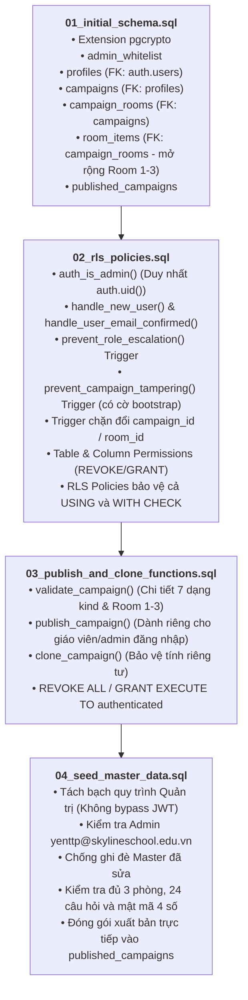

# BẢNG KIỂM TRA TRIỂN KHAI HỆ THỐNG SUPABASE
# DỰ ÁN AI ESCAPE LAB (DEPLOYMENT CHECKLIST)

---

## 1. THỨ TỰ THỰC THI MIGRATION VÀ CÁC PHỤ THUỘC (DEPENDENCY TREE)

Các tệp SQL Migration được thiết kế theo đúng trình tự phụ thuộc của cơ sở dữ liệu quan hệ PostgreSQL:



### Chi tiết các phụ thuộc:
- **Tệp 01 phải chạy đầu tiên**: Khởi tạo cấu trúc các bảng và khóa ngoại (`FOREIGN KEY`).
- **Tệp 02 phải chạy thứ hai**: Cần các bảng của tệp 01 để bật RLS, tạo trigger bảo vệ khóa ngoại và gán quyền cột.
- **Tệp 03 phải chạy thứ ba**: Cần các bảng và hàm `auth_is_admin()` từ tệp 02 để thực hiện validate và publish.
- **Tệp 04 chạy cuối cùng**: Cần tài khoản Admin trong `auth.users`, cấu trúc bảng và bảng `published_campaigns` đã sẵn sàng.

---

## 2. BẢNG KIỂM TRA THEO TỪNG GIAI ĐOẠN

### Giai đoạn A: Trước khi triển khai (Pre-deployment)
- [x] Đã trích xuất dữ liệu gốc của Room 01 (Khối 3, 4, 5) từ `game.js` sang `data/room01_master.json`.
- [x] Đã đối chiếu 1-1 toàn bộ 189 tiêu chí dữ liệu gốc (không sai lệch chữ số, mật mã, câu hỏi).
- [x] Đã kiểm thử 64/64 kịch bản logic phân quyền, bảo vệ khóa ngoại và cấu trúc 7 dạng câu hỏi qua runner Node.js.
- [x] Đã loại bỏ hoàn toàn `current_user` trong các hàm `SECURITY DEFINER`.
- [x] Đã phân quyền cấp cột trên `profiles`: Chặn giáo viên sửa `role` hoặc `email`.
- [x] Đã thêm trigger bảo vệ khóa ngoại `campaign_id` và `room_id` + chính sách RLS `USING`/`WITH CHECK` trên `campaign_rooms` và `room_items`: Chặn giáo viên chuyển dữ liệu sang bộ đề của người khác khi UPDATE.
- [x] Đã thêm cờ `app.is_admin_bootstrap` cô lập trong transaction quản trị (chặn tuyệt đối nếu `role` là `anon` hoặc `authenticated` hoặc có `auth.uid()`) để Seed và Trigger đồng bộ hoạt động trơn tru mà không tạo lỗ hổng cho người dùng thông thường.
- [x] Đã kiểm tra email xác thực ở cả Migration 01, 02 và 04: Chỉ cấp quyền Admin khi tài khoản trong `admin_whitelist` đã được xác minh (`email_confirmed_at IS NOT NULL`), không dựa vào metadata tự khai báo và không âm thầm nuốt lỗi.
- [x] Đã bổ sung quy trình validation tương đương 100% với `validate_campaign()` ngay trong Seed 04 (kiểm tra 3 phòng, 24 nhiệm vụ, cấu trúc JSONB 7 dạng câu hỏi, đáp án đúng, mật mã 4 số, chữ số thưởng, manh mối) và đối chiếu dữ liệu xuất bản trong `published_campaigns`.
- [ ] **Chờ Quản trị viên tạo tài khoản Admin**: `yenttp@skylineschool.edu.vn` trên Supabase Auth Dashboard (với tùy chọn Auto Confirm User = ON).
- [ ] **Chờ Quản trị viên phê duyệt chính thức** trước khi chạy bất kỳ lệnh nào.

### Giai đoạn B: Trong khi triển khai (Deployment)
Có thể lựa chọn 1 trong 2 phương án thực thi dưới đây sau khi được phê duyệt:

#### Phương án 1: Triển khai thủ công qua Supabase Web Dashboard (Khuyến nghị cho lần đầu)
1. Truy cập [Supabase Dashboard - SQL Editor](https://supabase.com/dashboard/project/sbbduxcjznoxrwhhchju/sql).
2. Tạo New Query, dán và nhấn **Run** lần lượt 4 tệp:
   - [ ] `supabase/migrations/20261102000001_initial_schema.sql` (Kiểm tra kết quả: *Success. No rows returned*).
   - [ ] `supabase/migrations/20261102000002_rls_policies.sql` (Kiểm tra kết quả: *Success. No rows returned*).
   - [ ] `supabase/migrations/20261102000003_publish_and_clone_functions.sql` (Kiểm tra kết quả: *Success. No rows returned*).
   - [ ] `supabase/migrations/20261102000004_seed_master_data.sql` (Kiểm tra kết quả: Notice *ĐÃ KHỞI TẠO VÀ XUẤT BẢN THÀNH CÔNG BỘ CÂU HỎI GỐC*).

#### Phương án 2: Triển khai tự động bằng Supabase CLI
Dành cho quy trình CI/CD hoặc môi trường dòng lệnh có cài đặt Supabase CLI:

```bash
# 1. Đăng nhập Supabase CLI bằng Personal Access Token
npx supabase login

# 2. Liên kết với dự án AI Escape Lab
npx supabase link --project-ref sbbduxcjznoxrwhhchju

# 3. Đẩy toàn bộ migrations lên database thật
npx supabase db push
```

### Giai đoạn C: Sau khi triển khai (Post-deployment Verification)
- [ ] Chạy tệp kiểm thử trực tiếp `scripts/test-database-security.sql` trong SQL Editor để xác minh 10 tiêu chí bảo mật trên PostgreSQL engine thật.
- [ ] Kiểm tra bảng `profiles`: Tài khoản `yenttp@skylineschool.edu.vn` có `role = 'admin'`.
- [ ] Kiểm tra bảng `campaigns`: Có 1 bản ghi với `share_code = 'MASTER'`, `is_template = true`.
- [ ] Kiểm tra bảng `campaign_rooms`: Có đúng 3 phòng (Lớp 3, 4, 5).
- [ ] Kiểm tra bảng `room_items`: Có đúng 24 thử thách (12 tasks, 12 secrets).
- [ ] Kiểm tra bảng `published_campaigns`: Có 1 bản ghi `share_code = 'MASTER'` chứa đầy đủ `published_payload`.
- [ ] Thử nghiệm truy vấn công khai bằng cURL hoặc trình duyệt:
  `GET https://sbbduxcjznoxrwhhchju.supabase.co/rest/v1/published_campaigns?share_code=eq.MASTER&select=share_code,version,title`

---

## 3. QUY TRÌNH XỬ LÝ SỰ CỐ VÀ PHỤC HỒI CÓ KIỂM SOÁT (SAFE ROLLBACK & RECOVERY)

> [!CAUTION]
> **Tuyệt đối không khuyến nghị sử dụng `DROP TABLE ... CASCADE` hàng loạt**, vì lệnh này sẽ xóa vĩnh viễn toàn bộ dữ liệu thật của học sinh và giáo viên trên môi trường production.

Trong trường hợp gặp lỗi hoặc gián đoạn trong quá trình triển khai, hãy tuân theo quy trình phục hồi có kiểm soát 4 bước sau:

### Bước 1: Sao lưu trước khi triển khai (Pre-migration Backup)
Trước khi áp dụng bất kỳ migration nào:
1. Vào mục **Database** $\rightarrow$ **Backups** trên Supabase Dashboard.
2. Tạo một bản sao lưu điểm phục hồi (Manual Backup Point).
3. Hoặc xuất dữ liệu hiện có qua lệnh:
   ```bash
   npx supabase db dump -f backup_before_migration.sql
   ```

### Bước 2: Kiểm tra trạng thái migration đã áp dụng
Kiểm tra xem migration nào đã chạy thành công và migration nào bị gián đoạn:
```sql
SELECT table_name FROM information_schema.tables WHERE table_schema = 'public';
```
Xác định chính xác tệp gây lỗi để xử lý cục bộ, không ảnh hưởng đến các thành phần đã chạy thành công.

### Bước 3: Xử lý lỗi từng migration (Isolated Remediation)
- **Nếu lỗi ở Tệp 04 (Seed Data)**: Dữ liệu cấu trúc bảng và RLS (Tệp 01-03) vẫn an toàn. Chỉ cần kiểm tra tài khoản Admin `yenttp@skylineschool.edu.vn` đã có trong `auth.users` chưa, sau đó chạy lại Tệp 04. Vì Tệp 04 có cơ chế kiểm tra `IF NOT EXISTS` và `ON CONFLICT DO NOTHING`, việc chạy lại hoàn toàn an toàn và không tạo bản ghi trùng lặp.
- **Nếu lỗi ở Tệp 03 (Functions)**: Các bảng không bị ảnh hưởng. Chỉ cần chỉnh sửa logic hàm và chạy lại lệnh `CREATE OR REPLACE FUNCTION ...`.
- **Nếu lỗi ở Tệp 02 (RLS & Triggers)**: Chỉ cần `DROP TRIGGER IF EXISTS ...` và `CREATE POLICY ...` lại cho bảng tương ứng.

### Bước 4: Phương án khôi phục có kiểm soát (Controlled Rollback)
Nếu bắt buộc phải hủy bỏ một đối tượng cụ thể mà không làm mất dữ liệu các bảng khác:
- Chỉ hủy bỏ bảng hoặc hàm vừa tạo gặp lỗi bằng lệnh đích danh:
  ```sql
  -- Ví dụ chỉ hủy bảng published_campaigns nếu bị sai cấu trúc:
  DROP TABLE IF EXISTS public.published_campaigns;
  ```
- Phục hồi lại dữ liệu từ bản backup đã tạo ở Bước 1 nếu có sự cố nghiêm trọng.
